# Planificateur de trajectoire autonome pour TurtleBot3 Burger

> Projet transverse ESIEE-IT 2026-2027. Un TurtleBot3 qui **cartographie** une salle,
> **calcule son chemin** (A\*, Dijkstra ou RRT), **le suit**, **évite les obstacles imprévus**
> et se pilote depuis un **téléphone**, sans application à installer.


<p align="center">
  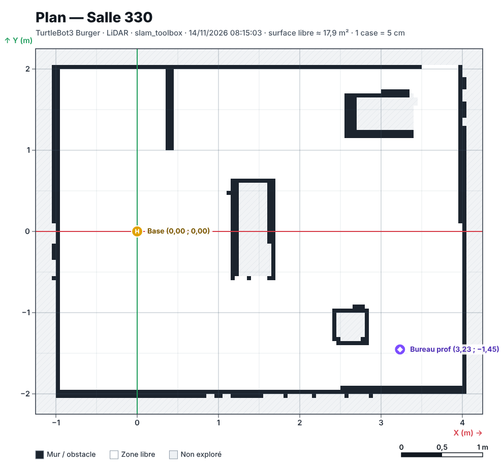
  <br><em>Plan exporté depuis le téléphone (bouton PLAN EN IMAGE), carte construite par slam_toolbox.</em>
</p>

---

## Sommaire

1. [En bref](#en-bref)
2. [Le matériel](#le-matériel)
3. [Organisation du dépôt](#organisation-du-dépôt)
4. [Phase 1 : les algorithmes (A\*, Dijkstra, RRT)](#phase-1--les-algorithmes)
5. [Phase 2 : navigation ROS 2 (RViz / Gazebo)](#phase-2--navigation-ros-2)
6. [La station de contrôle mobile](#la-station-de-contrôle-mobile)
7. [Cartographie : SLAM maison ou slam_toolbox](#cartographie--slam-maison-ou-slam_toolbox)
8. [Résultats](#résultats)
9. [Essayer le projet](#essayer-le-projet)
10. [Tests automatiques](#tests-automatiques)
11. [Limites et pistes](#limites-et-pistes)

---

## En bref

| | |
|---|---|
| **Problème** | Aller d'un point A à un point B dans une salle inconnue, sans heurter les murs ni les obstacles qui apparaissent en route. |
| **Planification** | A\*, Dijkstra et RRT codés à la main en Python, puis comparés (longueur, temps de calcul, nœuds explorés, virages). |
| **Suivi de chemin** | Contrôleur Pure Pursuit, vitesse plafonnée à 0,22 m/s (maximum du Burger). |
| **Perception** | LiDAR LDS-03 (360°, 10 Hz) et odométrie des roues. |
| **Cartographie** | SLAM léger maison (grille d'occupation + recalage de scans) **ou** slam_toolbox (fermeture de boucle). |
| **Interface** | Une page web servie par le robot, en forme de manette : carte en repère gradué, choix d'un point au doigt ou par coordonnées X/Y, voix, bilan de mission. |
| **Autonomie** | Exploration seule de la salle, relocalisation n'importe où sur une carte enregistrée, marche arrière pour se dégager, plusieurs cartes nommées. |
| **Qualité** | 66 tests automatiques, tous verts, lancés à chaque push par GitHub Actions. |

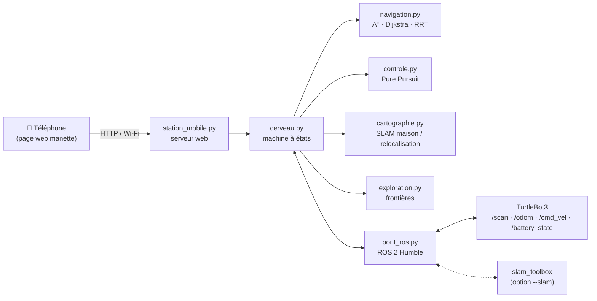

## Le matériel

| Élément | Détail |
|---|---|
| Robot | TurtleBot3 **Burger** |
| Ordinateur de bord | Raspberry Pi 4, Ubuntu 22.04, **ROS 2 Humble** |
| Carte moteurs | OpenCR (moteurs Dynamixel, IMU, mesure de la batterie, buzzer) |
| Capteur | LiDAR **LDS-03** |
| Réseau | Partage de connexion d'un iPhone : le robot, le PC et le téléphone sont sur le même réseau |

## Organisation du dépôt

| Dossier | Contenu |
|---|---|
| [`02_Guides/`](02_Guides) | Procédures pas à pas : préparer la Raspberry Pi et l'OpenCR, Wi-Fi, ROS 2 sur le PC (WSL2), premiers tests |
| [`03_Phase1_Algorithmes/`](03_Phase1_Algorithmes) | A\*, Dijkstra, RRT en Python pur (Windows, sans ROS), démo graphique et banc de comparaison |
| [`04_Phase2_Navigation_ROS2/`](04_Phase2_Navigation_ROS2/navigation_autonome) | Paquet ROS 2 `navigation_autonome` : planificateur sur `/map`, suivi Pure Pursuit, but cliqué dans RViz |
| [`05_Rapport/`](05_Rapport) | Chapitre « algorithmes » du rapport (PDF) |
| [`06_Test_moteurs/`](06_Test_moteurs) | Premier test des roues (boutons OpenCR puis Python) |
| [`07_Station_mobile/`](07_Station_mobile) | **Le démonstrateur** : robot autonome piloté depuis le téléphone ([mode d'emploi complet](07_Station_mobile/LISEZ-MOI.md)) |
| [`docs/images/`](docs/images) | Captures et résultats utilisés dans ce README |

## Phase 1 : les algorithmes

Python pur, testable sous Windows. La carte est une grille d'occupation au format ROS
(0 libre, 100 obstacle, -1 inconnu), les obstacles sont **gonflés du rayon du robot**
(0,105 m), puis le chemin est **lissé** par raccourcis.

- **Dijkstra** : explore en cercles autour du départ. Chemin optimal, mais beaucoup de cases visitées.
- **A\*** : même chose, guidé par une heuristique (distance au but). Même chemin optimal, bien moins de cases.
- **RRT** : arbre aléatoire qui pousse vers le but. Très rapide en espace ouvert, chemins plus longs, en difficulté dans les passages étroits.

<p align="center">
  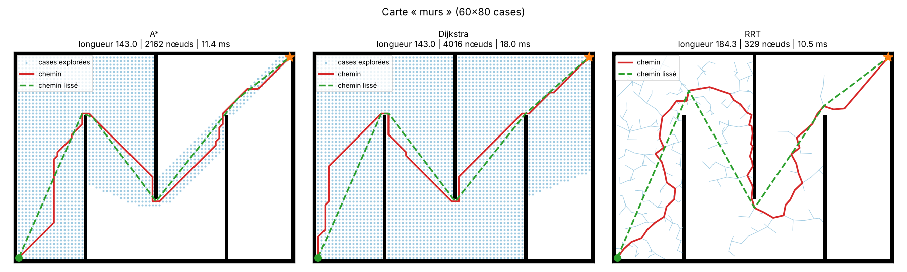
  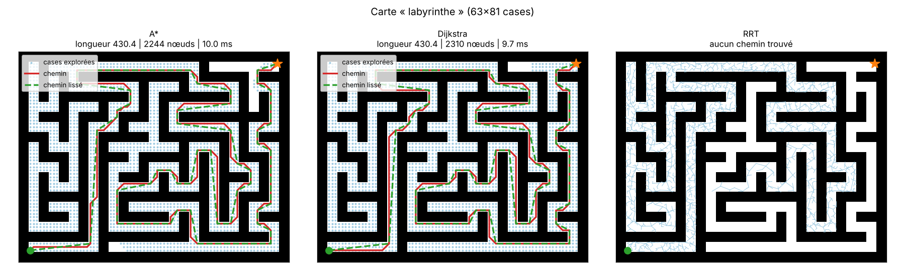
</p>

Détails, commandes et cartes de test : [`03_Phase1_Algorithmes/README.md`](03_Phase1_Algorithmes/README.md).

## Phase 2 : navigation ROS 2

Le paquet `navigation_autonome` branche ces algorithmes sur ROS 2 :

- le nœud **`planificateur`** lit `/map`, la position du robot et le but cliqué dans RViz, puis publie `/plan` ;
- le nœud **`suivi`** fait rouler le robot le long de `/plan` (Pure Pursuit sur `/cmd_vel`), s'arrête à 20 cm d'un obstacle et redemande un chemin s'il reste bloqué.

Installation et essai dans Gazebo : [`04_Phase2_Navigation_ROS2/navigation_autonome/README.md`](04_Phase2_Navigation_ROS2/navigation_autonome/README.md).

## La station de contrôle mobile

C'est le démonstrateur final. **Tout tourne sur la Raspberry Pi** ; le téléphone ouvre
simplement `http://<adresse-du-robot>:8080`.

<table>
  <tr>
    <td align="center">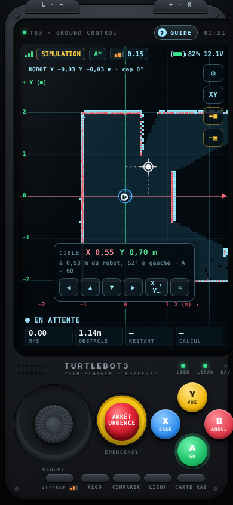<br><sub>Carte en <b>repère orthonormé gradué en mètres</b>, fiche de la cible</sub></td>
    <td align="center">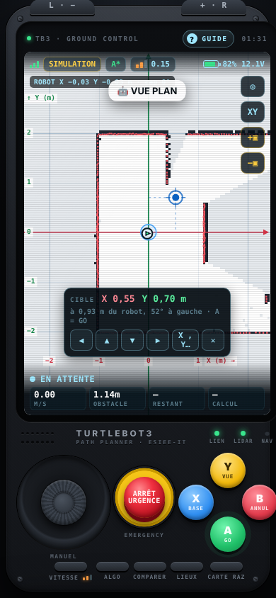<br><sub>Vue <b>PLAN</b> (fond blanc, comme un plan papier)</sub></td>
    <td align="center">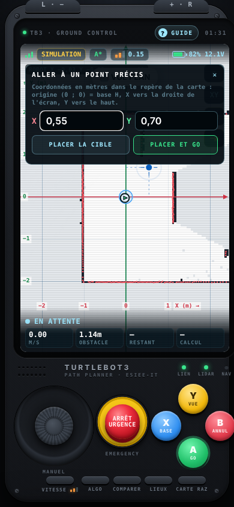<br><sub>Aller à un point précis : saisie <b>X / Y</b></sub></td>
  </tr>
  <tr>
    <td align="center">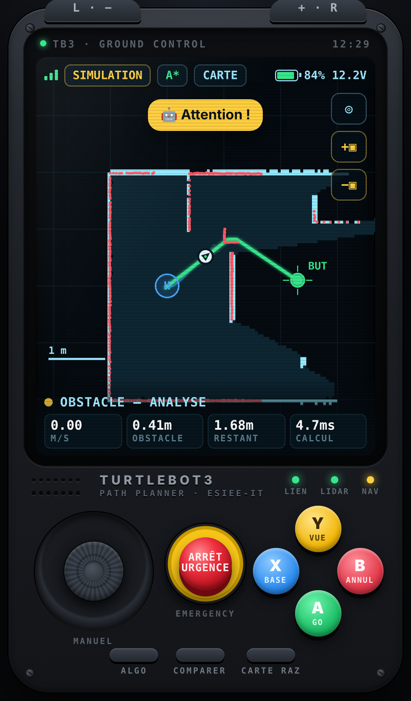<br><sub><b>Obstacle imprévu</b> : arrêt, annonce vocale, contournement</sub></td>
    <td align="center">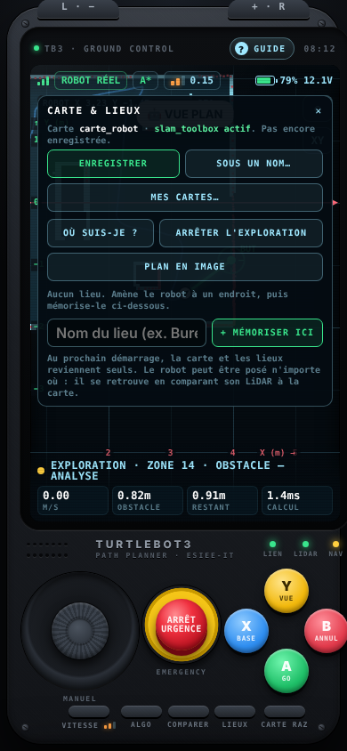<br><sub><b>Cartes et lieux</b> : enregistrer, explorer seul, plan en image</sub></td>
    <td align="center">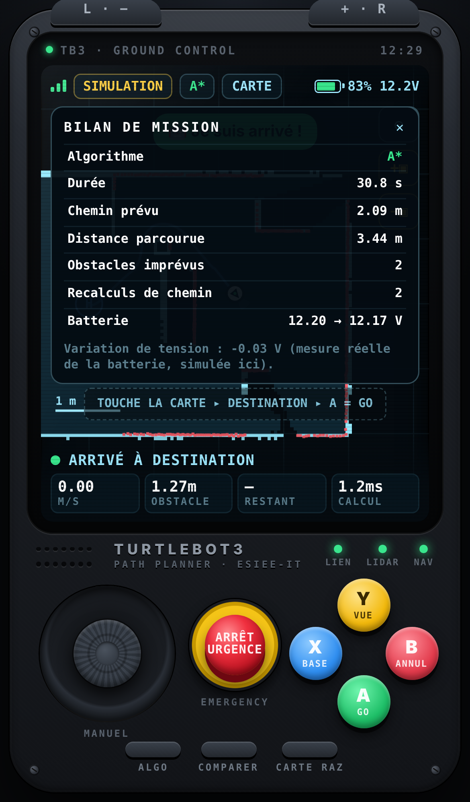<br><sub><b>Bilan de mission</b> : durée, distance, obstacles, batterie réelle</sub></td>
  </tr>
</table>

<p align="center">
  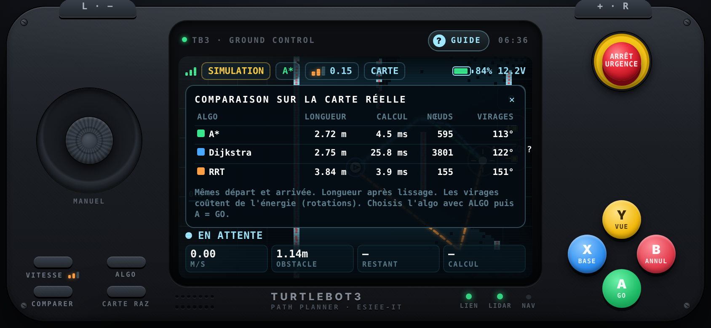
  <br><em>COMPARER : les 3 algorithmes sur la carte construite par le robot (téléphone en paysage).</em>
</p>

**Ce que fait le robot, tout seul :**

1. **Il cartographie** la pièce en roulant (LiDAR + odométrie).
2. **On choisit une destination** au doigt (calée à 5 cm près) ou en tapant ses coordonnées, puis **A = GO**.
3. **Il planifie** avec l'algorithme choisi (A\*, Dijkstra ou RRT), sur la carte gonflée du rayon du robot, puis **suit** le chemin.
4. **Obstacle imprévu** : il le voit au LiDAR, annonce sa distance et son côté (« Obstacle à 45 cm, devant à gauche »), s'arrête, puis repart, contourne, ou **recule de 20 cm** s'il est collé.
5. **Bulle de sécurité** : le virage en cours est prolongé sur 0,6 s ; si le bord du robot allait frôler un coin, même sur le côté, il s'arrête avant.
6. **Il se souvient de la pièce** : cartes nommées (« Salle 330 »), lieux mémorisés (« Bureau »), et **relocalisation globale** : posé n'importe où, il se retrouve seul en comparant son LiDAR à la carte, confirme avec une deuxième vue après un quart de tour, puis dit « Je sais où je suis ! ».
7. **EXPLORER SEUL** : il découvre une zone inconnue en allant de frontière en frontière, puis enregistre la carte.
8. **Sécurités** : vitesse plafonnée, homme mort en manuel, arrêt d'urgence, freinage progressif en manuel, pas de mission sans LiDAR récent ou sous 10,6 V.

Les données affichées sont **réelles** sur le robot : batterie (`/battery_state`, tension mesurée
par l'OpenCR), LiDAR (`/scan`), position (`/odom`), temps de calcul mesurés.

## Cartographie : SLAM maison ou slam_toolbox

| | SLAM maison (par défaut) | `--slam` : slam_toolbox |
|---|---|---|
| Principe | Grille d'occupation log-odds (cases de 5 cm) + recalage par corrélation de scans (± 10 cm, ± 4°) | SLAM à graphe de poses, standard de ROS 2 |
| Fermeture de boucle | Non | **Oui** : en repassant au même endroit, la carte est recollée |
| Installation | Rien (numpy) | `sudo apt install ros-humble-slam-toolbox` |
| Lancement | Par la station | **Par la station** (et relancé quand il faut) |
| Rechargement | Relocalisation globale sur la carte | Relocalisation globale, **puis** slam_toolbox reprend son graphe à cette position |

<p align="center">
  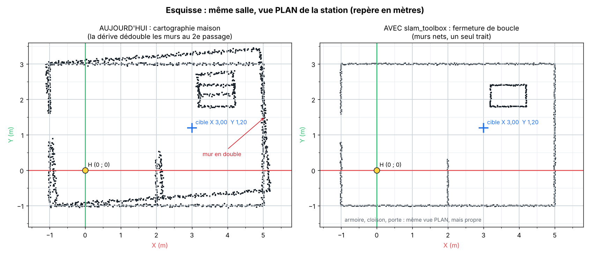
  <br><em>Illustration (dérive volontairement exagérée) : sans fermeture de boucle, un deuxième passage peut dédoubler les murs.</em>
</p>

Chaque carte enregistrée produit aussi le **plan au format ROS** (`.pgm` + `.yaml`, lisible par
RViz et Nav2) et, avec `--slam`, le graphe de slam_toolbox (`.posegraph` + `.data`).

## Résultats

### Phase 1 : comparaison des algorithmes (5 essais par carte)

| Carte | Algo | Succès | Longueur (cases) | Longueur lissée | Nœuds explorés | Temps |
|---|---|---:|---:|---:|---:|---:|
| vide | **A\*** | 100 % | 100,6 | 95,8 | **328** | 1,7 ms |
| vide | Dijkstra | 100 % | 100,6 | 95,8 | 4 524 | 20,0 ms |
| vide | RRT | 100 % | 111,8 | 95,8 | 113 | 1,1 ms |
| murs | **A\*** | 100 % | 143,0 | 134,2 | **2 162** | 11,2 ms |
| murs | Dijkstra | 100 % | 143,0 | 134,3 | 4 016 | 17,7 ms |
| murs | RRT | 100 % | 203,4 | 151,7 | 382 | 14,0 ms |
| labyrinthe | **A\*** | 100 % | 356,8 | 345,8 | 1 702 | 7,7 ms |
| labyrinthe | Dijkstra | 100 % | 356,8 | 345,3 | 1 862 | 7,5 ms |
| labyrinthe | RRT | **20 %** | 333,7 | 292,9 | 1 408 | 1 015 ms |
| aléatoire | **A\*** | 100 % | 105,3 | 100,6 | **852** | 4,2 ms |
| aléatoire | Dijkstra | 100 % | 105,3 | 100,2 | 3 591 | 15,5 ms |
| aléatoire | RRT | 100 % | 121,9 | 104,2 | 399 | 28,9 ms |

Données brutes : [`03_Phase1_Algorithmes/exemples/comparaison.csv`](03_Phase1_Algorithmes/exemples/comparaison.csv).

**À retenir :**
- **A\* et Dijkstra trouvent le même chemin optimal**, mais A\* explore 2 à 14 fois moins de cases sur les cartes ouvertes. Dans un labyrinthe l'écart disparaît : l'heuristique ne « voit » pas les murs.
- **RRT** est rapide en espace ouvert mais donne des chemins 11 à 42 % plus longs (le lissage rattrape l'essentiel), et **échoue souvent dans les passages étroits** (20 % de succès dans le labyrinthe).
- **Choix retenu pour le robot : A\***, optimal et le plus économe.

### Sur la carte construite par le robot (simulation)

| Algo | Longueur | Calcul | Nœuds | Virages cumulés |
|---|---:|---:|---:|---:|
| **A\*** | **2,72 m** | 4,5 ms | 595 | **113°** |
| Dijkstra | 2,75 m | 25,8 ms | 3 801 | 122° |
| RRT | 3,84 m | 3,9 ms | 155 | 151° |

### Navigation autonome

| Essai (simulation, robot virtuel avec odométrie qui dérive de 2 à 3 %) | Résultat |
|---|---|
| Missions A\*, Dijkstra avec obstacle surprise, RRT | Arrivée à moins de 8 cm, **0 collision** |
| Relocalisation globale (robot posé ailleurs, odométrie à zéro) | **48 / 48** positions correctes, aucune fausse, précision < 10 cm et 5° |
| Exploration autonome de la salle (5 m × 4 m, meubles) | Salle entière cartographiée (≈ 18 m² libres), **14 explorations sur 14 sans aucun contact** |
| Robot coincé devant une boîte | Recule de 20 cm, recalcule, arrive |
| slam_toolbox (ROS 2 Humble réel + faux robot ROS) | Exploration, enregistrement, redémarrage le robot posé ailleurs, relocalisation, reprise du graphe, mission vers un lieu mémorisé : **OK** |

## Essayer le projet

### Sur un PC Windows, sans robot (5 minutes)

```powershell
cd 07_Station_mobile
pip install numpy
python station_mobile.py --simulation
```

Puis ouvrir `http://localhost:8080` (ou double-cliquer sur `07_Station_mobile/1_essayer_sur_le_PC.bat`).
Un robot virtuel roule dans une salle virtuelle : tout se teste (exploration, missions, cartes, plan en image), sauf `--slam` qui demande ROS.

Phase 1 seule :

```powershell
cd 03_Phase1_Algorithmes
pip install -r requirements.txt
python demo.py --carte labyrinthe
python comparaison.py --csv resultats.csv
```

### Sur le vrai robot

```bash
# Depuis le PC (PowerShell) : copier le dossier sur la Raspberry Pi
scp -r 07_Station_mobile ubuntu@<ip-du-robot>:~/

# Terminal SSH n° 1 : démarrer le robot
ros2 launch turtlebot3_bringup robot.launch.py

# Terminal SSH n° 2 : la station (avec slam_toolbox, recommandé)
sudo apt install -y ros-humble-slam-toolbox      # une seule fois
python3 ~/07_Station_mobile/station_mobile.py --slam
```

Puis, sur le téléphone : `http://<ip-du-robot>:8080` → **DÉMARRER**.
Toutes les options et le dépannage : [`07_Station_mobile/LISEZ-MOI.md`](07_Station_mobile/LISEZ-MOI.md).

## Tests automatiques

| Partie | Commande | Tests |
|---|---|---:|
| Phase 1 | `cd 03_Phase1_Algorithmes && python -m pytest` | 18 |
| Phase 2 (sans ROS) | `cd 04_Phase2_Navigation_ROS2/navigation_autonome && python -m pytest test` | 11 |
| Station mobile | `cd 07_Station_mobile && python -m pytest tests` | 37 |

Les tests de la station font rouler le robot virtuel **en temps réel** (missions complètes,
obstacle surprise, relocalisation, exploration, cartes nommées, suivi de slam_toolbox) :
environ 5 minutes. GitHub Actions les lance à chaque push.

## Limites et pistes

- Sans `--slam`, le recalage corrige les petites dérives mais ne ferme pas les boucles.
- La relocalisation suppose que la pièce n'a pas trop changé depuis l'enregistrement ; dans une pièce très symétrique, le robot tourne pour trouver un détail qui tranche.
- Les zones inconnues sont supposées libres (exploration optimiste) : le robot replanifie quand il y découvre un mur.
- Pistes : RRT\* pour comparer à A\*, planification tenant compte de l'orientation (virages), Nav2 comme référence de comparaison.

---

<sub>Rayan, ESIEE-IT, projet transverse 2026-2027. Les guides détaillés sont en français, pas à pas.</sub>
